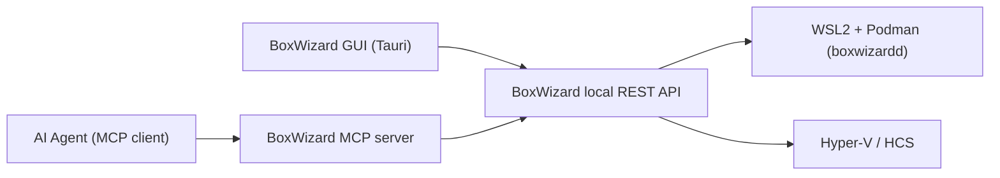

# MCP Server & Agent API Design

Status: Design v1, backed by a working scaffold in `packages/mcp-server` (mock
runtime adapter for now - wires to the real WSL2/Hyper-V backends described in
`docs/runtime-container-prototype.md` and `docs/runtime-vm-prototype.md` as a
follow-up).

## Why MCP + a plain REST API, not just one

- **MCP server**: the natural integration point for AI coding agents (Cursor,
  Claude, etc.) already speaking MCP - zero custom glue code for an agent that
  wants to provision a sandbox mid-task.
- **REST API underneath**: the MCP server is a thin adapter over a local HTTP
  API (`localhost` only, no auth needed for MVP since it never leaves the
  machine). The same REST API is what the Tauri GUI calls. This avoids
  duplicating lifecycle logic between "the GUI path" and "the agent path" - both
  go through one BoxWizard local service.



## Tool surface (MCP tools = REST endpoints)

| MCP tool | REST equivalent | Purpose |
|---|---|---|
| `list_templates` | `GET /templates` | List built-in + user-defined environment templates (see `docs/mvp-features.md` catalog). |
| `create_environment` | `POST /environments` | Create a container or VM sandbox from a template or raw image ref. Returns immediately with an id and status; TTL clock starts now. |
| `list_environments` | `GET /environments` | List all environments (running, queued, recently destroyed) with kind, status, TTL remaining. |
| `get_environment` | `GET /environments/:id` | Full detail for one environment (connection info, resource usage, logs pointer). |
| `exec_command` | `POST /environments/:id/exec` | Run a command inside a **container** environment and return stdout/stderr/exit code. Not applicable to VM environments in MVP (see below). |
| `extend_environment` | `POST /environments/:id/extend` | Push out the TTL deadline by N seconds, capped by a server-side max. |
| `destroy_environment` | `DELETE /environments/:id` | Immediately tear down, regardless of TTL. |

### `create_environment` input shape

```json
{
  "kind": "container | vm",
  "template": "python-3.12 | node-22 | ubuntu-desktop-gui | windows-gui | null",
  "image": "optional OCI image ref, used if template is null (container only)",
  "ttlSeconds": 3600,
  "resources": { "cpus": 2, "memoryMb": 2048 },
  "ports": [{ "containerPort": 3000, "hostPort": 0 }],
  "startupCommand": "optional shell command run once on start (container only)"
}
```

Server-side, `ttlSeconds` is always clamped to a hard max (default 4 hours,
configurable in app settings) regardless of what's requested - this is the
mandatory-TTL guardrail from `docs/mvp-features.md`, enforced once, in one place,
for both the GUI and the agent path.

### Why VM environments don't get `exec_command` at MVP

VMs are for GUI/website testing, not headless command execution (that's what
containers are for). Driving a VM's GUI programmatically (mouse/keyboard
injection, screenshotting) is real, valuable, and explicitly listed as a
**post-MVP stretch goal** in `docs/mvp-features.md` - the tool surface below
reserves the names but the scaffold returns `501 Not Implemented` for them so the
contract is visible now without committing to the implementation yet:

- `vm_screenshot` (`GET /environments/:id/screenshot`)
- `vm_input` (`POST /environments/:id/input`)

## Error model

All endpoints return a consistent error shape so an agent can reliably branch on
failure:

```json
{ "error": { "code": "ttl_exceeded_max | not_found | runtime_unavailable | invalid_template", "message": "human-readable" } }
```

## Scaffold in this repo

`packages/mcp-server/` contains:
- `src/runtimeAdapter.ts` - the interface the real WSL2/Hyper-V backends will
  implement, plus an in-memory mock implementation used for now so the MCP tool
  surface and REST layer can be built/tested before the native backends exist.
- `src/restApi.ts` - Express app implementing the REST endpoints above against
  whatever `RuntimeAdapter` is injected.
- `src/mcpServer.ts` - wraps the REST API's logic as MCP tools using
  `@modelcontextprotocol/sdk`, so both the GUI (via REST) and an agent (via MCP)
  share the exact same lifecycle code path.
- `src/index.ts` - entrypoint that starts both the REST server and the MCP
  server (stdio transport) against the mock adapter, for local testing.

This scaffold was smoke-tested locally (see terminal output in this session) by
calling `create_environment`, `list_environments`, `exec_command`, and
`destroy_environment` end-to-end against the mock adapter.
