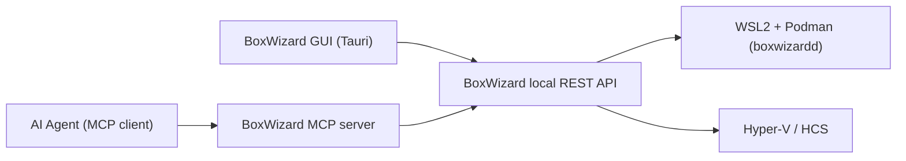

# MCP Server & Agent API Design

Status: Design v1, backed by a working scaffold in `packages/mcp-server`. By
default the scaffold now runs against real backends - `DockerRuntimeAdapter`
(Docker/Podman via `dockerode`) for containers and `HyperVRuntimeAdapter`
(PowerShell + Hyper-V cmdlets) for VMs - composed with the in-memory
`MockRuntimeAdapter` by `CompositeRuntimeAdapter`, which routes each
`create_environment` call to whichever engine the caller picked via `runtime`
(see "Tool surface" below), matching `docs/runtime-container-prototype.md`
and `docs/runtime-vm-prototype.md`. Setting `BOXWIZARD_RUNTIME_MODE=mock`
forces the entire process onto `MockRuntimeAdapter` for GUI/MCP development
without Docker/Hyper-V installed at all.

## Why MCP + a plain REST API, not just one

- **MCP server**: the natural integration point for AI coding agents (Cursor,
  Claude, etc.) already speaking MCP - zero custom glue code for an agent that
  wants to provision a sandbox mid-task.
- **REST API underneath**: the MCP server is a thin adapter over a local HTTP
  API (`localhost` only, no auth needed for MVP since it never leaves the
  machine). The same REST API is what the Tauri GUI calls. This avoids
  duplicating lifecycle logic between "the GUI path" and "the agent path" - both
  go through one BoxWizard local service.



## Tool surface (MCP tools = REST endpoints)

| MCP tool | REST equivalent | Purpose |
|---|---|---|
| `list_templates` | `GET /templates` | List built-in + user-defined environment templates (see `docs/mvp-features.md` catalog). |
| `add_template` | `POST /templates` | Add a custom template from an arbitrary OCI image reference (e.g. Docker Hub `postgres:16`). Verified against Docker Hub before saving unless it targets another registry. Persisted to `~/.boxwizard/custom-templates.json`. |
| `remove_template` | `DELETE /templates/:id` | Remove a previously added custom template. Built-in templates cannot be removed. |
| - | `GET /templates/dockerhub-search?q=` | Search Docker Hub's public repository index; backs the GUI's "Add template" dialog. Not exposed as an MCP tool since it's just a UI convenience. |
| `list_runtimes` | `GET /runtimes` | List which backend engines (`runtime` values) are valid for each `kind` - `{ "container": ["docker","mock"], "vm": ["hyperv","mock"] }`. |
| `create_environment` | `POST /environments` | Create a container or VM sandbox from a template or raw image ref, on a chosen backend engine (`runtime`). Returns immediately with an id and status; TTL clock starts now. |
| `list_environments` | `GET /environments` | List all environments (running, queued, recently destroyed) with kind, status, TTL remaining. |
| `get_environment` | `GET /environments/:id` | Full detail for one environment, including live `usage` (CPU%/memory) and `connection` (browser-tab access link) - see below. |
| _(REST-only)_ | `GET /environments/:id/stats` | On-demand live CPU/memory sample, same shape as the `usage` field. |
| `exec_command` | `POST /environments/:id/exec` | Run a command inside a **container** environment and return stdout/stderr/exit code. Not applicable to VM environments in MVP (see below). |
| `extend_environment` | `POST /environments/:id/extend` | Push out the TTL deadline by N seconds, capped by a server-side max. |
| `destroy_environment` | `DELETE /environments/:id` | Immediately tear down, regardless of TTL. |

### `create_environment` input shape

```json
{
  "kind": "container | vm",
  "runtime": "docker | hyperv | mock (optional; defaults to the first entry for kind - docker/hyperv)",
  "template": "python-3.12 | node-22 | ubuntu-desktop-gui | windows-gui | null",
  "image": "optional OCI image ref, used if template is null (container only)",
  "ttlSeconds": 3600,
  "resources": { "cpus": 2, "memoryMb": 2048 },
  "ports": [{ "containerPort": 3000, "hostPort": 0 }],
  "startupCommand": "optional shell command run once on start (container only)"
}
```

`runtime` picks the backend engine per launch, independent of the
process-wide `BOXWIZARD_RUNTIME_MODE` env var (see `README.md`): `docker` and
`hyperv` are the real engines for `container`/`vm` respectively, and `mock` is
always available for either kind as an in-memory simulation - useful for
testing the GUI/agent flow without touching real Docker or Hyper-V. Requesting
a `runtime` that isn't valid for the given `kind` (e.g. `hyperv` with
`kind=container`) returns `invalid_runtime`. Call `list_runtimes` /
`GET /runtimes` to discover valid combinations instead of hardcoding them.

Server-side, `ttlSeconds` is always clamped to a hard max (default 4 hours,
configurable in app settings) regardless of what's requested - this is the
mandatory-TTL guardrail from `docs/mvp-features.md`, enforced once, in one place,
for both the GUI and the agent path.

### Why VM environments don't get `exec_command` at MVP

VMs are for GUI/website testing, not headless command execution (that's what
containers are for). Driving a VM's GUI programmatically (mouse/keyboard
injection, screenshotting) is real, valuable, and explicitly listed as a
**post-MVP stretch goal** in `docs/mvp-features.md` - the tool surface below
reserves the names but the scaffold returns `501 Not Implemented` for them so the
contract is visible now without committing to the implementation yet:

- `vm_screenshot` (`GET /environments/:id/screenshot`)
- `vm_input` (`POST /environments/:id/input`)

## Live usage & remote access

`EnvironmentRecord` (returned by `create_environment`, `list_environments`,
`get_environment`) carries two additional fields, refreshed on every read
while the environment is `running`:

```json
{
  "usage": { "cpuPercent": 12.4, "memoryUsedMb": 340, "memoryLimitMb": 1024, "sampledAt": "..." },
  "connection": { "type": "terminal", "url": "/environments/:id/terminal" }
}
```

- `usage` is `null` unless the environment is `running`. Containers sample it
  from the Docker/Podman stats API; VMs sample it from Hyper-V's `Get-VM`.
- `connection.url` is a path on the same REST API host. The GUI opens it
  directly in a new browser tab (`window.open`):
  - **container** -> `{ type: "terminal", url: "/environments/:id/terminal" }`,
    a WebSocket upgrade path served by `public/terminal.html` (xterm.js),
    bridged to a real `docker exec` session by `wsBridge.ts`.
  - **vm** -> `{ type: "vnc", url: "/vnc-proxy/:id", host, port }`, a raw
    WebSocket<->TCP proxy served by `public/vnc.html` (noVNC), bridged to the
    VM's VNC server by `wsBridge.ts`. `host` is `null` until the VM's guest IP
    is resolved via Hyper-V Integration Services; the GUI disables the "Open
    Console" button until then. The guest OS must be running a VNC server on
    `port` (default 5900, override via `BOXWIZARD_VM_VNC_PORT`) - BoxWizard has
    no way to install one inside an arbitrary base image.

## Error model

All endpoints return a consistent error shape so an agent can reliably branch on
failure:

```json
{ "error": { "code": "ttl_exceeded_max | not_found | runtime_unavailable | invalid_template | invalid_runtime", "message": "human-readable" } }
```

## Scaffold in this repo

`packages/mcp-server/` contains:
- `src/runtimeAdapter.ts` - the interface the real WSL2/Hyper-V backends will
  implement, plus an in-memory mock implementation used for now so the MCP tool
  surface and REST layer can be built/tested before the native backends exist.
- `src/restApi.ts` - Express app implementing the REST endpoints above against
  whatever `RuntimeAdapter` is injected.
- `src/mcpServer.ts` - wraps the REST API's logic as MCP tools using
  `@modelcontextprotocol/sdk`, so both the GUI (via REST) and an agent (via MCP)
  share the exact same lifecycle code path.
- `src/index.ts` - entrypoint that starts both the REST server and the MCP
  server (stdio transport) against the mock adapter, for local testing.

This scaffold was smoke-tested locally (see terminal output in this session) by
calling `create_environment`, `list_environments`, `exec_command`, and
`destroy_environment` end-to-end against the mock adapter.
