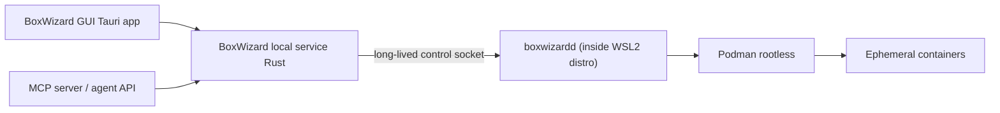

# Prototype Findings: Bundled WSL2 Container Runtime

Status: Validated on this dev machine (Windows 10/11, WSL2, no Hyper-V dependency).

## What was tested

`scripts/prototypes/wsl-container-runtime/setup-distro.ps1` was run end-to-end:

1. Downloaded the Alpine Linux minirootfs (small, fast).
2. Imported it as a brand-new, isolated WSL2 distro (`BoxWizard-Runtime-Prototype`),
   independent of the user's existing `Ubuntu` distro and independent of the
   `docker-desktop` distro that Docker Desktop had already installed on this
   machine (confirmed via `wsl -l -v` before running the prototype - proving we do
   not need to touch or depend on an existing Docker Desktop installation).
3. Installed **Podman** (rootless-capable, daemonless, no licensing restrictions)
   plus its minimal deps (`fuse-overlayfs`, `shadow-uidmap`, `crun`, `netavark`)
   via `apk`. Total footprint: **89 MiB across 75 packages**.
4. Smoke-tested by pulling `alpine:3.20` from Docker Hub and running a command
   inside a container from Windows via `wsl -d <distro> -- podman run ...`.
5. Measured warm container start+exit latency: **~4.5 seconds** for a `podman run
   --rm alpine:3.20 true` round-trip (includes `wsl -d` process invocation
   overhead, not just container start - see notes below).

## Conclusions

- **Feasible and fast to build.** A dedicated, BoxWizard-owned WSL2 distro with
  Podman is a ~90 MiB, few-minute setup, fully scriptable, and requires no admin
  elevation on this machine to import a distro or install packages inside it.
- **No Docker Desktop dependency.** The prototype distro is completely separate
  from `docker-desktop`'s own internal WSL distro. This confirms the plan's
  approach: BoxWizard can ship and manage its own container runtime and never
  require the user to install/license Docker Desktop.
- **OCI-compatible out of the box.** Podman pulled a standard `docker.io` image
  with zero extra configuration, confirming the "stay OCI/Docker-image
  compatible" recommendation from market research is a non-issue technically.
- **Latency is acceptable for "short-lived," not "instant."** The ~4.5s measured
  is dominated by the `wsl -d <distro> -- ...` invocation path (each `wsl`
  command from Windows pays a process-launch + distro-wake cost) rather than pure
  container start time. Production BoxWizard should keep a long-lived lightweight
  agent process running *inside* the WSL distro (started once when BoxWizard
  launches) that receives create/exec/destroy requests over a local socket,
  avoiding the repeated `wsl -d ...` invocation cost per operation. This is the
  same pattern Docker Desktop and Rancher Desktop use internally and should be
  adopted for BoxWizard's real implementation, not just shelling out to `wsl` per
  call.
- **Rootless hardening is a follow-up, not a blocker.** This prototype ran Podman
  as root inside the distro (Alpine default) for simplicity. Production setup
  should configure `/etc/subuid`/`/etc/subgid` and rootless Podman per the
  official Alpine/Podman rootless guide referenced in `setup-distro.ps1`'s output,
  matching the "isolation defaults" requirement in `docs/mvp-features.md`.

## Recommended production architecture (based on this prototype)



- `boxwizardd`: a small long-lived daemon inside the dedicated WSL2 distro,
  started once, exposing create/list/exec/destroy over a Unix socket forwarded to
  a named pipe on the Windows side. Avoids per-call `wsl -d` overhead.
- The Windows-side BoxWizard service talks to `boxwizardd` for all container
  operations and to the VM runtime (see `docs/runtime-vm-prototype.md`) for VM
  operations, presenting one unified API to both the GUI and the MCP server.

## Cleanup

The prototype distro can be removed at any time:

```powershell
.\scripts\prototypes\wsl-container-runtime\setup-distro.ps1 -Cleanup -DistroName BoxWizard-Runtime-Prototype
```

It was left installed on this machine after validation so it can be reused for
the next prototype step (MCP server integration testing) without re-downloading;
remove it once no longer needed for development.
